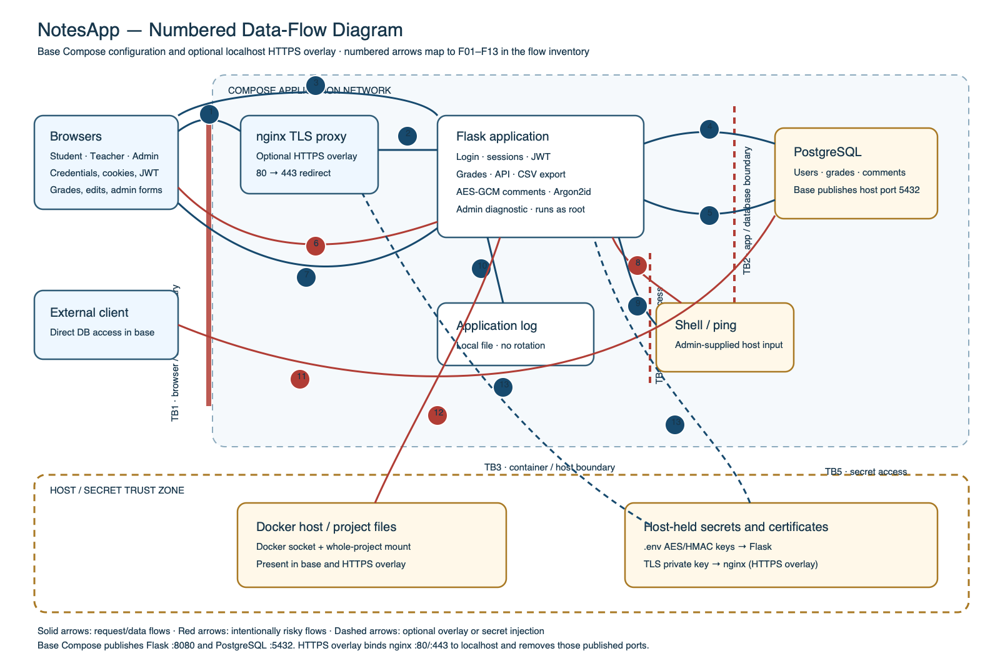

# Project 1 — NotesApp threat model

## Purpose and scope

This threat model covers the local NotesApp teaching stack: a browser, the Flask
application, PostgreSQL, and the optional nginx HTTPS reverse proxy. It focuses on
the confidentiality and integrity of student grades, comments, account credentials,
and application secrets. The app is deliberately vulnerable; this is a coursework
analysis, not a claim that the system is safe to deploy.

Included: login and sessions, student and teacher pages, grade changes, CSV export,
the notes API, administration features, database storage, application logs, and the
optional local TLS setup.

Excluded: public cloud hosting, institution identity providers, real student data,
external email services, and production operations. The supplied accounts and data
are synthetic. Keep the stack bound to localhost and do not expose it to untrusted
networks.

## Numbered data-flow diagram and trust boundaries

The diagram describes the checked-in base Compose configuration and its optional
HTTPS overlay. The overlay changes the browser entry point and removes published
app/database ports; it does not remove the app container's Docker socket or project
directory mounts.

Editable vector source: [notesapp-data-flow.svg](notesapp-data-flow.svg).

| Boundary | Separates | Why it matters |
|---|---|---|
| **TB1 — browser/service** | User-controlled browsers from the public app entry point | Base mode publishes HTTP on 8080. HTTPS overlay accepts localhost HTTP/HTTPS at nginx, redirects HTTP, and proxies to Flask over the Compose network. |
| **TB2 — app/database** | Flask process and PostgreSQL over the Compose network | The app holds database credentials and has broad access to application records. Base mode publishes PostgreSQL port 5432; the HTTPS overlay removes that host port. |
| **TB3 — app/host** | Container from the Docker host and project files | Base Compose mounts the Docker socket and the whole project directory into a root-running container, weakening container isolation. HTTPS overlay retains these mounts. |
| **TB4 — app/OS process** | Web request data from the shell and operating system | The admin diagnostic passes user-controlled text to a shell command. |
| **TB5 — secrets/configuration** | Host-held keys/configuration from app and proxy processes | The app receives comment-encryption and export-HMAC keys; nginx reads the local TLS private key. Protect backups and preserve keys for existing data. |

### Flow inventory

Each F-number in the diagram maps to one row here and to the STRIDE assessment
below. Arrows marked as base/overlay alternatives depend on the selected Compose
configuration.

| ID | Sender → receiver | Data crossing the flow | Entry point / implementation |
|---|---|---|---|
| F01 | Browser → nginx (HTTPS overlay) or Flask (base) | Initial page and login credentials | HTTP 80 redirects to HTTPS in overlay; base exposes Flask at 8080 |
| F02 | nginx → Flask | Proxied request and headers over internal HTTP | `nginx/nginx.conf`; overlay only |
| F03 | Flask → browser through nginx or directly | HTML/redirects, session cookie, JWT embedded in dashboard page | Flask routes and `login`; JWT is returned in the page for API use |
| F04 | Flask → PostgreSQL | Authentication SELECT and business SQL, including reads/writes | `login`, `dashboard`, `api_notes`, `teacher`, `grades`, `export_csv`, admin routes |
| F05 | PostgreSQL → Flask | User/role/password records, grade/comment rows, query results | Same route handlers; app decrypts comments after reading them |
| F06 | Browser → Flask (via nginx in overlay) | Authenticated requests and grade/admin form input; cookie or bearer JWT | `/dashboard`, `/api/notes/<id>`, `/teacher`, `/grades`, `/admin`, `/export.csv` |
| F07 | Flask → browser (via nginx in overlay) | Rendered grades/comments, JSON records, CSV export and HMAC footer | Templates, `api_notes`, `export_csv` |
| F08 | Flask → shell/process | `ping` command assembled using admin-provided host text | `admin_ping`; `subprocess.run(..., shell=True)` |
| F09 | Shell/process → Flask | Command output, error text, or timeout result | `admin_ping` |
| F10 | Flask → local application log | Login outcomes and grade/admin diagnostic events | `log`; local file, with write errors ignored |
| F11 | External client → PostgreSQL (base Compose only) | Direct DB protocol, credentials and SQL over published port 5432 | `db.ports` in base Compose; removed by HTTPS overlay |
| F12 | Flask container → Docker host/project files | Docker API via mounted socket and access through whole-project bind mount | `web.volumes` in base Compose; retained by HTTPS overlay; app container runs as root |
| F13 | Host secret/config files → Flask/nginx | AES-GCM and HMAC keys to Flask; TLS certificate/private key to nginx | `.env` environment and read-only nginx cert mount |

F04/F05 represent database exchanges for authentication and application operations;
F01/F06 and F03/F07 distinguish unauthenticated entry/login from authenticated
functionality and its resulting data. These are logical flows, not a claim that
each request creates a separate network connection.

## Assets and security goals

| Asset | Security goal | Impact if compromised |
|---|---|---|
| Student grades and teacher comments | Confidentiality and integrity | Privacy harm, incorrect academic outcomes |
| Usernames, passwords, and account roles | Confidentiality and authenticity | Account takeover and privilege abuse |
| Session cookies and bearer tokens | Authenticity and authorization | Impersonation and unauthorized record access |
| Comment encryption key | Confidentiality of encrypted comments | Stored ciphertext can be exposed |
| Export HMAC key | Integrity/authenticity of exported CSVs | Forged exports may validate |
| Database contents and availability | Integrity and availability | Data loss, tampering, or service outage |
| Application logs | Appropriate accountability and confidentiality | Investigation gaps or exposure of sensitive values |
| TLS private key | Confidentiality and server authenticity | Local TLS impersonation |

## Actors and assumptions

| Actor | Intended access | Relevant trust assumption |
|---|---|---|
| Student | Own grades and comments | Authenticated account does not imply access to other students' records |
| Teacher | Classes and grades they are responsible for | Teacher role must be scoped to assigned classes |
| Administrator | User and class management | Administrative actions are especially sensitive |
| Unauthenticated visitor | Login and public endpoints | May submit arbitrary requests and input |
| Host operator | Local containers, volumes, and secret files | Controls the machine running the lab |
| Malicious or curious course user | May interact with the intentionally vulnerable app | Must remain within the local, synthetic lab environment |

Assume the host and Docker daemon are trusted for this local exercise. Do not put
real credentials or student records in the test database. A compromised Flask
process can use its database credentials and encryption keys; encryption at rest
does not protect data from a running, authorized application process.

## STRIDE analysis and risk scoring

S = spoofing, T = tampering, R = repudiation, I = information disclosure,
D = denial of service, E = elevation of privilege.

The following is a threat assessment of the **intentionally vulnerable base
application**, not a record that every scenario was exploited. Each threat is
attached to one or more numbered flows. Likelihood (L) and impact (I) are rated
1–3; risk is `L × I`. Ratings: 1–2 low, 3–4 medium, 6–9 high. Likelihood means
relative ease in the local teaching setup, not an observed attack frequency.

| ID | STRIDE / flow | Threat and code-grounded exposure | L | I | L×I | Recommended mitigation |
|---|---|---|---:|---:|---:|---|
| T01 | S — F01, F04 | Predictable seeded account passwords permit account impersonation if reused or guessed | 2 | 3 | 6 | Replace default credentials, use unique strong passwords, add rate limiting and MFA |
| T02 | I — F01, F02 | Base mode sends credentials and session traffic over plain HTTP; overlay protects browser-to-nginx only | 2 | 3 | 6 | Require TLS on every exposed entry point; do not publish the base HTTP app |
| T03 | T/E — F01, F04 | Login SQL concatenates the submitted username, allowing query alteration | 3 | 3 | 9 | Parameterize all queries and return generic authentication errors |
| T04 | D — F01, F04 | Login/database requests have no visible rate limit or account throttling | 2 | 2 | 4 | Add rate limits, bounded request sizes, and database/app timeouts |
| T05 | S/E — F03, F06 | JWT verifier accepts `alg:none`; HS256 also uses a short default secret, so token identity is not trustworthy | 3 | 3 | 9 | Use a maintained JWT library, pin the accepted algorithm server-side, reject unsigned tokens, use a high-entropy secret, validate claims/expiry |
| T06 | I/E — F06, F07 | Notes API does not verify that the authenticated identity owns the requested note; bearer identity can be forged | 3 | 3 | 9 | Enforce per-record authorization on every API read; never treat token role claims as authorization without validated identity |
| T07 | T/E — F06, F07 | Teacher route and grade update do not scope classes/notes to the teacher's assigned classes | 2 | 3 | 6 | Check teacher-to-class and note-to-class ownership in both reads and writes |
| T08 | T — F06, F07 | Grade and admin state-changing forms omit CSRF checks | 2 | 3 | 6 | Use CSRF tokens and validate request origin; set appropriate cookie protections |
| T09 | I/T — F05, F07 | Comments are rendered with Jinja autoescape disabled; stored markup can execute in viewers' browsers | 2 | 3 | 6 | Restore autoescaping and sanitize only explicitly supported rich text |
| T10 | I — F05, F07 | Teacher pages and exports return broad grade sets rather than enforcing class ownership | 2 | 3 | 6 | Apply authorization predicates in each database query and export path |
| T11 | R — F08, F09, F10 | Admin command and grade changes have no protected, complete audit trail; log writes can silently fail | 2 | 2 | 4 | Record actor, target, action, outcome and timestamp in protected structured audit storage; report logging failures |
| T12 | T/E — F08, F09 | Admin diagnostic concatenates user input into a shell command with `shell=True`; app container runs as root | 2 | 3 | 6 | Remove shell invocation; if diagnostics remain, use a fixed executable and validated argument list under a non-root identity |
| T13 | D — F08, F09, F10 | Unbounded output, repeated diagnostics, and unrotated logs can consume process memory, CPU, or disk | 2 | 2 | 4 | Bound output, add timeouts/rate limits, rotate logs, and enforce resource limits |
| T14 | I/T/E — F11 | Base Compose publishes PostgreSQL on host port 5432 with fixed coursework credentials | 2 | 3 | 6 | Do not publish the DB port; use per-environment credentials and least-privilege DB roles |
| T15 | E/I — F12 | Root-running app container has Docker socket and whole-project host bind mounts | 2 | 3 | 6 | Remove Docker socket and broad bind mount; run as non-root with minimal read-only mounts |
| T16 | I/T — F13 | Application keys are available to the app process; host/key disclosure allows decrypting stored comments or forging HMACs | 2 | 3 | 6 | Restrict host file access, back up keys securely, separate keys by purpose, and rotate with a migration plan |
| T17 | D — F04, F05, F11 | Database is a shared dependency with no visible connection/request quotas | 2 | 2 | 4 | Bound connection pools, query duration, request volume, and export size |

**Coverage check:** all six STRIDE categories have at least one scored threat:
Spoofing (T01/T05), Tampering (T03/T07–T09/T12), Repudiation (T11),
Information disclosure (T02/T06/T09/T10/T14/T16), Denial of service
(T04/T13/T17), Elevation of privilege (T03/T05–T07/T12/T14/T15).

## Top three risks and acceptance criteria

1. **T03 — login SQL injection (9, high):** parameterize the username query.
   **Accept when** SQL metacharacters are treated as literal username data, valid
   seeded logins continue to work, and database errors are not returned to users.
2. **T05 — JWT identity spoofing (9, high):** reject unsigned tokens, pin HS256 (or
   another deliberately selected algorithm), rotate the weak secret, and validate
   required identity and expiry claims. **Accept when** unsigned, malformed,
   expired, and invalid-signature tokens are rejected.
3. **T06 — record-level authorization bypass (9, high):** authorize every note read
   against the validated caller identity and role. **Accept when** an authenticated
   user cannot read another user's note, while permitted reads still work.

T15 (container-to-host privilege boundary, 6/high) should also be addressed before
deployment: remove the Docker socket and whole-project mount, and run the app as a
non-root user. Accept when the app has no host Docker API access, only the minimum
required files are mounted, and the process runs without root privileges.

These are proposed remediations and test criteria, not claims that the vulnerabilities
have been fixed. This coursework version intentionally retains them.

## Coursework controls and limitations

- **AES-GCM comments:** comments are encrypted with a per-record nonce and record
  ID as authenticated additional data; startup migrates plaintext comments and
  validates already-encrypted values. Losing or replacing the key makes comments
  unreadable. The database and application process still need access to plaintext
  when displaying or exporting comments.
- **CSV HMAC:** a verifier detects changes to a CSV body when the correct secret key
  is available. HMAC does not provide non-repudiation, and a party holding the key
  can generate another valid MAC.
- **HTTPS overlay:** local TLS protects browser traffic in transit to nginx. The
  self-signed certificate is for local testing only, and the base HTTP setup remains
  available for coursework comparison.
- **Argon2id:** new accounts use Argon2id; a legacy password is upgraded after a
  successful login. Seeded accounts are still initialized with weak plaintext
  passwords, and accounts that never log in are not upgraded automatically.
- These controls are partial lab exercises. The deliberately planted authentication,
  authorization, input-handling, and operational flaws remain and must be fixed
  before a real deployment.

## Verification and evidence record

Run the applicable tests and scripts locally, then record the actual output and
date for your submission. Do not invent screenshots, packet captures, or classroom
observations.

| Check | Command / action | Evidence |
|---|---|---|
| Compose configuration | `docker compose config -q` with the base and HTTPS files | Both configurations validated successfully |
| Utility tests | `docker compose exec -T -w /host web python -m unittest discover -s tests -v` | 9 tests passed on 2026-10-27 using Python 3.11.18 |
| Comment encryption behavior | Start the app and check the seeded rows; teacher page displays decrypted comments | Startup migrated all non-null comments; database count for remaining plaintext comments was 0 |
| Export integrity | Sign in as the synthetic teacher and request `/export.csv` | Original export verified; a locally modified export was rejected |
| HTTPS behavior | `scripts/smoke_https.py` after starting the HTTPS Compose overlay | HTTPS `/login` returned 200; HTTP `/login` returned 301 to `https://localhost/login` |
| Password migration | Sign in once with the seeded teacher account; inspect only whether its stored value has the Argon2 prefix | Successful login upgraded that legacy password to Argon2id |
| Password audit | `docker compose exec -T -w /host web python -m labs.class05.password_audit` | Local synthetic measurements recorded in [results.json](../class05/results.json) on 2026-10-27 using Python 3.11.18 |
| Threat-model review | Compare this analysis with the routes and data flows | Add course-specific instructor feedback if required |

The local Docker HTTPS stack was started and these checks passed on 2026-10-27.
It is bound to localhost. The database uses a local Compose volume and the existing
ignored `.env` keys; preserve both if you want to keep using this database.
