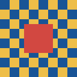
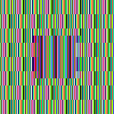
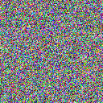

# Session 03 — Symmetric encryption

Use synthetic text and a generated pattern image; the scripts do not need course
slides or downloaded images.

```sh
python3 labs/session03/caesar.py
python3 -m venv .venv
.venv/bin/pip install -r labs/session03/requirements.txt
.venv/bin/python labs/session03/task2.py
```

The Caesar exercise ranks all 26 shifts using English letter-frequency chi-square
scores. Its ranking is a statistical guess and may fail on short or non-English text.

The image exercise encrypts raw RGB pixels rather than compressed PNG bytes. ECB
uses PKCS7 padding and preserves repeated 16-byte blocks; GCM uses a random key and
12-byte nonce and authenticates the ciphertext. The script verifies both
round-trips. The output ciphertext-preview PNGs discard padding/tag bytes and are
visualizations only; the ephemeral key is not saved, so these images are not backups.

Latest local run:





The script writes its current run summary to `task2_output/results.txt`.
